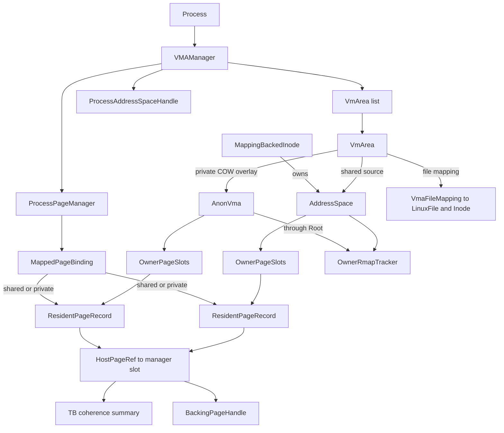
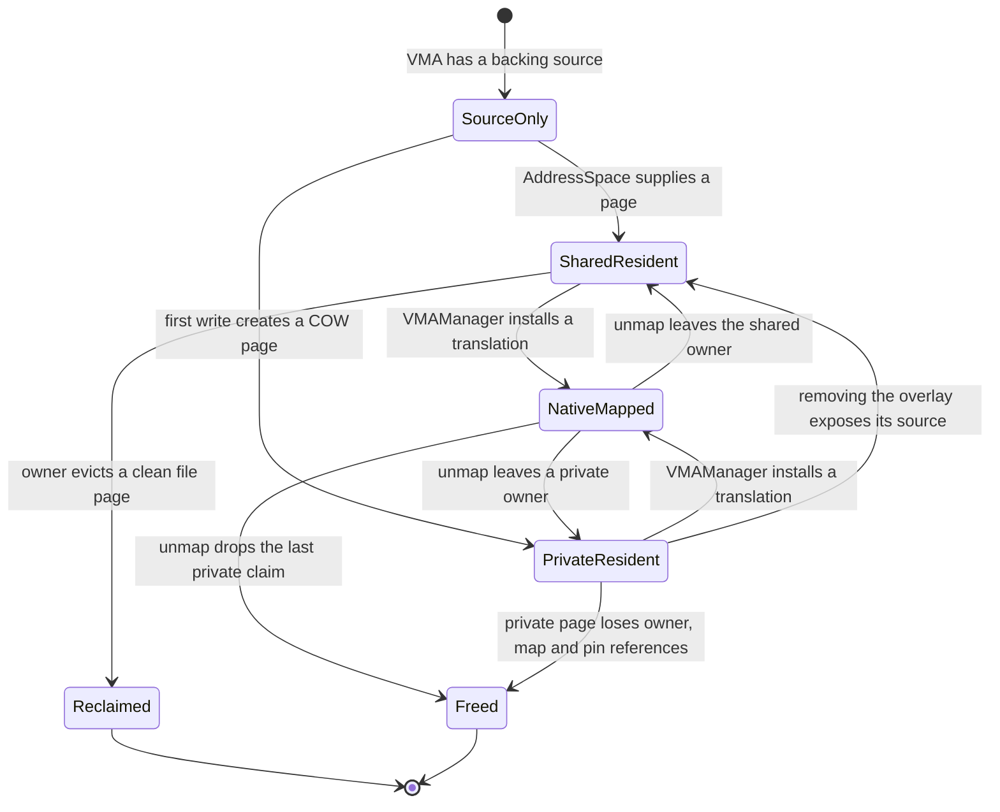

# Guest memory management

Fiberish manages guest virtual ranges and resident backing pages in C#.
The native MMU installs guest-to-host translations on demand. Removing a
translation leaves the page contents intact while a managed owner retains
the backing page. See the [native MMU lifecycle](mmu-lifecycle-model.md) for
core sharing, code-cache invalidation and block storage reclamation.

## 1. Object relationships

| Object | Owner | Responsibility |
|---|---|---|
| `VMAManager` | Process address space, shared with `CLONE_VM` | Keep a sorted VMA list, resolve faults, track mapped inodes and publish address-space changes. |
| `VmArea` | `VMAManager` | Describe a guest range, permissions, flags, offsets and backing sources. |
| `AddressSpace` | Mapped inode or zero source | Own resident pages for file, shared-memory and zero-backed mappings. |
| `AnonVma` | Private mapping lineage | Own private COW pages and keep fork-related owners under one rmap root. |
| `OwnerPageSlots` | `AddressSpace` or `AnonVma` | Map an owner-local page index to a `ResidentPageRecord`. |
| `HostPageManager` | `MemoryRuntimeContext` | Resolve live host pointers to generation-checked metadata slots. |
| `ProcessPageManager` | `VMAManager` | Record installed `MappedPageBinding`s by guest page address and account for their map references. |

`ProcessAddressSpaceHandle` retains the MMU identity used for engine
attachment and translated-block coherence. `VMAManager` records code-cache
reset ranges and `ProcessAddressSpaceSync` coordinates changes across the
engines attached to that address space. See [VMAManager](../Fiberish.Core/Memory/VMAManager.cs)
and [address-space synchronization](../Fiberish.Core/Memory/ProcessAddressSpaceSync.cs).

## 2. Page ownership and identity

A VMA's `VmMapping` supplies its backing pages. Private writes use a
`VmAnonVma` overlay. Anonymous private reads use a shared
`AddressSpaceKind.Zero` mapping from `ZeroInode`. The runtime implements
`MAP_SHARED | MAP_ANONYMOUS` with an internal shmem file. SysV SHM also uses
shmem-backed `AddressSpace` objects. `VmArea` computes guest addresses and
file offsets through its page-index helpers. See [VmArea](../Fiberish.Core/Memory/VmArea.cs)
and [managed owners](../Fiberish.Core/Memory/LinuxMemoryObjects.cs).

`OwnerPageSlots` holds a dictionary of `ResidentPageRecord` values. A record
carries a pointer, a `HostPageRef` and, for file-backed pages, a
`FilePageIdentity` and any inode release information. Slot insertion and removal
update owner claims, then notify rmap code of binding changes.

`HostPageManager` keeps one metadata slot per live host pointer in a
`MemoryRuntimeContext`. A `HostPageRef` carries the table, slot index and
generation. The manager can grow the slot array and reuse an index after
retirement. Access through a matching generation resolves the current slot.
`HostPageData` holds dirty, uptodate and writeback flags, the last access
timestamp, owner binding, counts and a translated-block coherence summary.

A host pointer identifies a live view. `FilePageIdentity` identifies a file
page by device, inode number and page index, including when a backend replaces
a window or uses distinct views for one file page. `BackingPageHandle` carries
a pointer, release owner and token. The release owner returns an anonymous
page to `BackingPagePool` or releases an inode-backed lease.
See [resident slots](../Fiberish.Core/Memory/OwnerPageSlots.cs),
[host-page metadata](../Fiberish.Core/Memory/HostPageRef.cs) and
[file-page identity](../Fiberish.Core/Memory/FilePageIdentity.cs).

## 3. Reverse mapping and executable aliases

Reverse mapping finds the guest VMAs and addresses that refer to a host page.
Both `AddressSpace` and `AnonVma` record attachments for the owner-page ranges
covered by their VMAs. A binding change updates resident refs for the affected
attachments. Each `AddressSpace` maintains its own `OwnerRmapTracker`. Fork-related
`AnonVma` objects use the tracker on `Root`, while each concrete `AnonVma` keeps
its own resident slots and VMA attachments.

`OwnerRmapTracker` groups refs by owner page index and host pointer. Each
`HostPageRmapRef` identifies a `VMAManager`, VMA, owner kind, page index and
guest address. Installing a private page removes the shared rmap ref at that
index for the affected VMA. Removing the private page restores the shared ref
if the source page still exists. VMA splits rebind refs to the new range
objects without moving the backing pages.

`HostPageTbCohSummary` tracks writers and identities that map an executable
alias. Its policy permits all writers, protects all writers, or exempts one
executable identity. `TbCoh` uses it and the reverse refs to find executable
peers on a write fault and update native protection and code-cache
invalidation. Each `VMAManager` records pages with temporary TB-coherence
write protection in `_tbWpPages`. See [coherence tracking](../Fiberish.Core/Memory/TbCoh.cs).

## 4. Faults and native mappings

On a shared-source fault, `VMAManager` resolves the page from the zero mapping,
the `MappingBackedInode` page cache or a shmem `AddressSpace`. For hostfs and
SilkFS on supported hosts, the mapped backend supplies a lease into a host
file-cache window. Backend selection can use a buffered provider when host
geometry cannot support the mapped backend. See [backend selection](../Fiberish.Core/Memory/FilePageBackendSelector.cs)
and [mapped windows](../Fiberish.Core/Memory/WindowedMappedFilePageBackend.cs).

| Private fault | Resolution |
|---|---|
| Read with a private page | Install the existing private page with write permission cleared. |
| Read without a private page | Install the shared source with write permission cleared. An ELF synthetic zero tail can require a private copy to zero part of the last file page. |
| Write with a private page and at most one resident owner | Mark the existing page dirty and install it writable, subject to coherence protection. |
| Write with a private page and multiple resident owners | Pin the source during the copy and install a replacement in the faulting owner. |
| First private write | Copy the shared source, create the `AnonVma` if needed and install the private page. |

`EnsureNativeMapping` refreshes permissions with `Engine.MemProtect` if the
installed pointer already matches. For a different pointer, it calls
`MemMapHostPage` while the old managed binding still retains its backing.
It then releases the old binding and records the new one. `ProcessPageManager.AddBinding`
and `Release` adjust `MapCount`. See [mapping install and fault handling](../Fiberish.Core/Memory/VMAManager.cs)
and [installed binding accounting](../Fiberish.Core/Memory/ProcessPageManager.cs).

## 5. Resident page lifetime

The owner tracks residency through `OwnerResidentCount`. The installed
binding tracks mapping through `MapCount`, and a managed pin holds the backing
through `PinCount`. A private page can survive a native unmap while another
owner retains it. `ProcessPageManager.Release` can remove an unpinned, unmapped
private page if it is the last resident owner and the operation permits
releasing the owner binding.

`HostPageRef.TryRemoveIfUnused` checks that the live slot has no owner root,
resident owners, installed mappings or pins. It returns the slot to the
manager and releases any backing handle outside the table lock.
`ZeroInode` owns the shared zero page for its own lifetime. See
[retirement and pin handling](../Fiberish.Core/Memory/HostPageRef.cs).

## 6. Range edits and file invalidation

### Fork

`CLONE_VM` shares the managed address space and native core. A separate
address space captures dirty private state, copies native mappings with
the same backing pointers, and clones the managed VMAs. Each child
`AnonVma` takes owner claims on the inherited private pages and keeps the
parent's rmap root. The fork path removes child translations for
`MADV_DONTFORK` and `MADV_WIPEONFORK` ranges, rebuilds the installed-binding
table and clears write permissions on parent and child private mappings.
The child drops inherited lock flags. A later write fault copies the page
if owners still share it. See [fork](../Fiberish.Core/Core/FiberTask.cs).

### `mprotect`, `munmap` and `mremap`

- `mprotect` validates range coverage and permissions, splits or updates
  VMAs, and rebinds rmap refs. The code reprotects existing translations and
  preserves COW protection on private pages. `PROT_NONE` tears down installed
  translations in the range.
- `munmap` schedules shared file writeback as needed, rewrites the VMA ranges
  and removes native translations. During teardown, `preserveOwnerBinding`
  lets the operation release the bindings before it removes the selected
  private owner slots. The operation recomputes TB-coherence protection.
- `mremap` moves existing page references and adjusts native bindings as
  required. Lazy ranges can move with their backing and offsets intact
  without copying guest data for the range.

`MemoryRuntimeContext.MaxMapCount` defaults to 65,530 guest VMAs. VMA edits
check available capacity before operations that split ranges. See [VMA edits](../Fiberish.Core/Memory/VMAManager.cs)
and [memory syscall entry points](../Fiberish.Core/Syscalls/SyscallHandlers.Memory.cs).

### Truncate and backing invalidation

On truncate, the mapped inode adjusts its page cache and
`ProcessAddressSpaceSync` notifies the affected address spaces.
`VMAManager.OnFileTruncate` records code-cache reset ranges, releases affected
guest locks, removes affected native translations and truncates the private
owner tables beyond the new EOF. An address space without an available
engine records the native changes for later application. On Windows,
the inode can suspend mapped views during a resize. The fault path reports
`SIGBUS` for file accesses past the mapped backing.

`UnmapMappingRange` finds overlapping guest ranges for a file interval.
With `evenCows` clear, it preserves materialized private COW pages and
invalidates private translations that still reference the shared source.
With `evenCows` set, it includes the private COW ranges in native teardown.
See [inode mutation](../Fiberish.Core/VFS/Structs.cs) and
[native teardown coordination](../Fiberish.Core/Memory/ProcessAddressSpaceSync.cs).

## 7. Writeback, reclaim and residency

Shared file writeback samples native dirty state into the managed owner,
then the inode writes or flushes the affected pages. The call path
distinguishes writeback from durability. Private COW writes stay in the
`AnonVma`. `AddressSpacePolicy` accounts for file and shmem owners and
considers clean file-cache pages for eviction in least-recently-used order.
The owner checks for mappings, pins and multiple owner claims before
releasing a slot. Private pages follow their owner and mapping lifetimes.

A backing lease keeps a view alive. A managed pin prevents removal of a
host page while its caller uses it. A host memory lock applies to native
page coverage through `HostMemoryLockTracker` or the mapped backend. The
guest uses 4 KiB pages and accounts for its own locked ranges. Host locks
can cover a larger range on hosts with larger pages. `mincore` consults
managed residency or the backing provider, depending on the source. A
lease alone gives no guarantee about physical RAM residency.

See the [direct-mapped memory refactor record](direct-mapped-memory-refactor-plan.md)
and [LTP test report](../tests/ltp/MEMORY_FIX_REPORT.md) for completed work and
compatibility limits. [Slot ownership](hostpage-slot-ownership-design.md) and
[the stable-object alternative](hostpage-linux-style-design.md) document
earlier design choices.
